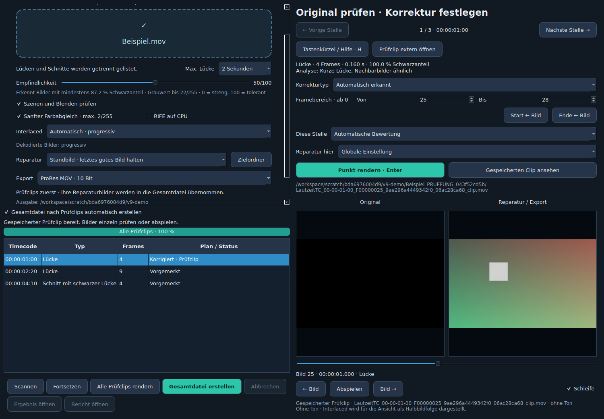

# VideoRepairMac-RIFE

Lokale macOS-App zum Erkennen, Prüfen und Reparieren schwarzer Bildlücken mit
RIFE, Optical Flow und weiteren Methoden. Projekt: **krejuee**, mit Unterstützung
von ChatGPT/Codex entwickelt.

**Aktuell: Version 9** – mit Lücken bis **2 Sekunden**, Deutsch/Englisch,
**8-/10-Bit-SDR** und fortsetzbarem Gesamtexport. Quellcode, Modell und Tests
im Hauptordner sind der aktuelle V9-Stand.

**Neu:** ProRes/MOV ist der Standardexport. Nach „Alle Prüfclips rendern“ wird
die Gesamtdatei standardmäßig ohne Rückfrage erstellt. „Titel erhalten“ wurde
entfernt; die Erkennung von Titeln über Schwarz bleibt erhalten.

[English documentation](README_EN.md) · [Deutsche Anleitung](LIESMICH.md)

## Download und Installation

1. [VideoRepairMac-RIFE-v9.zip herunterladen](https://github.com/krejuee/VideoRepairMac-RIFE/releases/download/v9.0.0/VideoRepairMac-RIFE-v9.zip)
   und entpacken. Ältere ZIPs bleiben als Archiv verfügbar.
2. Python **3.12 oder 3.11** für macOS installieren:
   [python.org](https://www.python.org/downloads/macos/).
3. **Installieren.command** öffnen. Die Pakete werden heruntergeladen und
   `~/Applications/Video Repair RIFE 9.app` wird erstellt.

Voraussetzungen: macOS 14+, Intel oder Apple Silicon, Internet zur Installation,
etwa 4 GB für den Build und zusätzlicher Platz für Videos und Prüfclips.
Das Paket enthält Quellcode und Modell, kein vorgebautes/notarisiertes App-Bundle.
macOS-Build und Apple-GPU/MPS sind noch nicht auf Apple-Hardware nachgewiesen.

## Bedienung

**Datei laden → Scannen → Ereignisse prüfen → Prüfclips rendern → Gesamtdatei.**
Das Laden startet keine Analyse. Die Empfindlichkeit aktualisiert nach dem Scan
die Liste ohne erneutes Lesen des Videos. Ein Klick auf eine Stelle öffnet die
Originalvorschau; Typ, Framebereich und Methode sind pro Ereignis einstellbar.



Abbildung: synthetischer Democlip in der Linux-Testumgebung.

## Funktionen in V9

- Ereignisliste für Lücken, Schnitte, Schnitt mit schwarzer Lücke und Blenden.
- Bildweise Vorschau, Ereignisnavigation, Wiedergabe und Tastenkürzel; **L** setzt
  eine manuelle Lücke, **Enter** rendert die gewählte Stelle.
- RIFE 4.25 Standard und Qualität, Optical Flow, Standbild und Überblendung.
- Schnitt-Lücken: Bewegungsverlängerung aus bis zu sechs intakten Bildern der
  ausgehenden Szene, danach harter Schnitt.
- Automatische TFF/BFF-Erkennung, manuell überschreibbar; getrennte Halbbildreparatur.
- Separate Prüfclips und verlustfreie Reparatur-Patches vor dem Gesamtexport.
  Passende Reparaturen werden auch nach einem Exportwechsel wiederverwendet.
- **Fortsetzen** nach Abbruch: geprüfte Exportabschnitte bleiben erhalten. Nach
  Neustart scannt „Fortsetzen“ die unveränderte Quelle einmal und stellt die
  gespeicherten Entscheidungen wieder her. Derselbe Zielordner ist erforderlich.
- Sprache während der Arbeit zwischen Deutsch und Englisch umschaltbar.
- FFV1/MKV für verlustfreie 8-/10-Bit-Master, H.264/MOV für 8 Bit,
  ProRes/MOV für 10 Bit sowie XDCAM HD422/MXF ausschließlich für 8-Bit-Quellen.
- Originalton im Gesamtexport; Prüfclips ohne Ton. Timecode und unterstützte
  Metadaten werden übernommen, weitere lesbare Tags im Bericht abgelegt.
- Fortschrittsanzeige und Abbruch. Originaldateien bleiben unverändert.

Für einen Lauf über Nacht: Datei laden, scannen, Einstellungen/Plan prüfen,
**„Gesamtdatei nach Prüfclips automatisch erstellen“** aktiv lassen und
**„Alle Prüfclips rendern“** starten. Ist der Schalter aus, fragt die App vor
dem Gesamtexport nach. Einzelne Prüfclips starten keinen Gesamtexport.

MKV bleibt optional verfügbar; das gemeldete Wiedergabeproblem wurde bisher
nicht abschließend geklärt.

## Was ist RIFE?

RIFE ist ein neuronales Verfahren zur Zwischenbildberechnung. Aus intakten
Nachbarbildern berechnet es plausible fehlende Bilder; verlorene Originalinhalte
kann es nicht exakt wiederherstellen. Das enthaltene Practical-RIFE-4.25-Modell
arbeitet lokal. Standard berechnet ein Ergebnis, Qualität mittelt 16 räumliche
und zeitliche Varianten. Das benötigt mehr Zeit und kann Details glätten.
Schnitt-Lücken verwenden eine separate Bewegungsprognose.

## Dokumentation und Entwicklung

- [Ausführliche Anleitung und Tastenkürzel](LIESMICH.md)
- [Prüfbericht des V9-Pakets](PRUEFUNG.md) und [aktueller Import-Testlauf](REPOSITORY_CHECKS.md)
- [Versionsübersicht](CHANGELOG.md)
- [Beiträge und Fehlerberichte](CONTRIBUTING.md)
- [Drittanbieter und Herkunft](THIRD_PARTY_NOTICES.md)
- [MIT-Lizenz des Projekts](LICENSE)

```bash
python3.12 scripts/prepare_package.py
python3.12 -m venv .venv
source .venv/bin/activate
python -m pip install -r requirements.txt
python app.py
```

Tests: `python -m unittest discover -s tests -v`; Metadatentests benötigen
`ffprobe` im PATH. Unter Linux für die GUI-Tests `QT_QPA_PLATFORM=offscreen` setzen.
Das Vorbereitungsskript setzt die drei Distributionsdateien zum ZIP zusammen
und stellt die enthaltenen Gewichte in `models/rife425/flownet.pkl` bereit. Herkunft und
SHA-256 stehen in [vendor_rife/HERKUNFT.md](vendor_rife/HERKUNFT.md).

Lücken über zwei Sekunden, HDR/PQ/HLG und Rotationsmetadaten werden nicht
unterstützt. Rekonstruktionen und Schnittentscheidungen im Prüfclip kontrollieren.
Den vollständigen Prüfclip-Ordner einschließlich Index, Patches und Exportteilen
bis zur Abnahme des Ergebnisses behalten.
