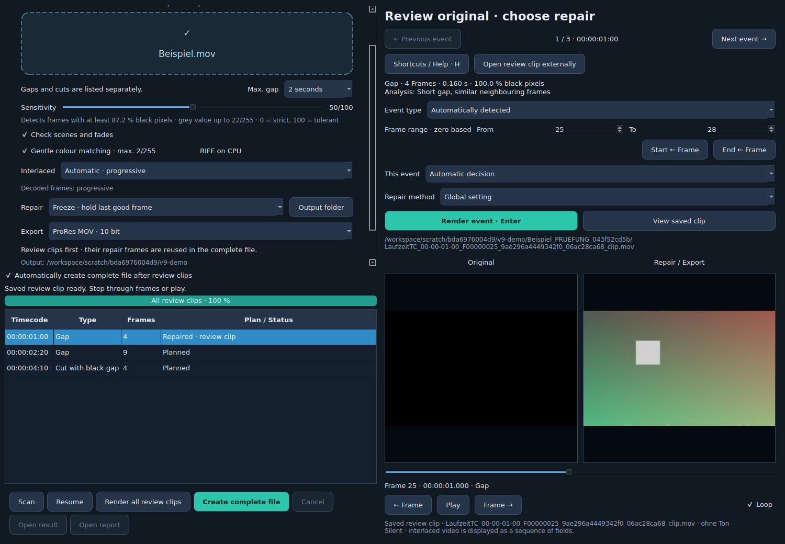

# Video Repair RIFE 9

Repair short black gaps in 8-bit and 10-bit SDR video. German and English UI;
local processing with the included Practical-RIFE 4.25 model.

## New in V9

**ProRes/MOV is the default export**, including for 8-bit input. The removed
"Preserve titles" feature no longer composites damaged pixels into repairs;
detection of titles over black stays unchanged. Saved V8 title flags are ignored.
Patches produced with title compositing are not reused.

**Automatically create complete file after review clips** is enabled by default.
For overnight processing: load → scan → check settings/plan → leave the switch
on → **Render all review clips**. A single selected-event render stays separate.
Switch it off for the previous Yes/No confirmation. Matching clips and export
parts are reused. V8 MKV preferences migrate once to ProRes; explicit V9 choices
remain saved. MKV remains optional; its reported playback problem has not been
conclusively diagnosed.

## Workflow

1. Load a file. Loading never starts a scan or a render automatically.
2. Press **Scan**. The growing event list remains interactive. Sensitivity and the
   maximum gap length update cached results without another scan.
3. Select an event to inspect the original, step through frames or play it.
   Choose its type, repair decision, method and frame range.
4. Press **Render event / Enter**. The original and repaired review clips, plus a
   lossless native repair patch, are saved first. Review clips are silent, with
   about a second of context on each side. Inspect the saved result on the right.
5. **Render all review clips** processes the planned repairs. Completed events
   stay available for review while the next event is rendering.
6. **Create complete file** reuses matching repair patches. Missing repairs are
   rendered first. The default-enabled automatic complete-file switch starts
   the final export without a dialog. Turn it off to be asked first.

Ordinary cuts have no missing frames. **L** sets a repair range there, initially
one frame. Use From/To (zero based) or Start/End ← Frame to adjust it. Overlapping
repairs are rejected. Maximum gap: **2 seconds**, using actual frame timestamps.

## Resume and reuse

Keep the original source unchanged and use the **same output folder**. Keep its
whole `name_PRUEFUNG_<id>` folder. **Resume** uses the existing analysis within a
session. After reopening the app it explicitly scans once, restores decisions
and settings, then continues. Loading a file alone does not start work.

Native repair pixels have a separate fingerprint from export format and UI
language. Changing containers never requires repeating a matching AI repair.
Previous setting variants are retained, so switching back can reuse an older
patch. Matching V7 patches can be imported from the same review folder.

The complete video is encoded as roughly ten-second, verified parts. Completed
parts survive cancellation or process termination. A changed repair invalidates
only overlapping parts; a different output codec needs new encoded parts, while
its native repair patches are reused. The final pass joins compressed packets
and copies original audio without encoding them again. If that pass is cancelled,
only joining restarts. A matching, completed output is verified and reused.

Size and SHA-256 checks detect damaged cache files. Atomic per-event journals
help recover a damaged main index. Extra encoded parts require disk space.
Do not remove the project folder until the finished output is accepted.

## Methods and shortcuts

RIFE estimates intermediate images with a neural network. Standard uses one
variant; Quality combines 16 variants in Float32. Other methods are Optical
Flow, motion extension, freeze, blend and nearest neighbour.

For a **cut with black gap**, motion is extended from up to **six intact frames
of the outgoing scene**, followed by a hard cut to the new scene. The scenes are
not blended. At least two references are needed. Motion estimation cannot
recover unseen detail; long gaps, occlusions and acceleration can cause artefacts.

| Key | Action |
| --- | --- |
| U | Skip and continue |
| L | Mark / repair gap |
| C | Cut with black gap; extend motion |
| A / D | Previous / next event |
| I / O | Blend / Optical Flow |
| N / Q | RIFE Standard / Quality |
| B | Preserve fade |
| Enter | Render selected event |
| Space | Play / pause |
| Left / Right | Step through frames |
| H / F1 | Help |

## Bit depth, fields and formats

10-bit SDR YUV 4:2:0, 4:2:2 and 4:4:4 are supported, including TFF/BFF.
Reconstruction uses high precision; only the on-screen preview is reduced to
8-bit display values. Intact native fields are preserved in lossless output.
Field order is detected from decoder flags and can be overridden. Interlaced
4:2:0 requires height divisible by four. HDR/PQ/HLG is rejected.

| Export | Behaviour |
| --- | --- |
| FFV1/MKV | Lossless native 8/10 bit; intact decoded pixels are verified |
| High quality MOV | H.264 CRF 12 for 8-bit input; ProRes for 10-bit input |
| ProRes/MOV | 10-bit 4:2:2 HQ, or 4444 profile for 4:4:4/RGB input |
| XDCAM MXF | **8-bit** MPEG-2 4:2:2, 50 Mbit/s; 10-bit input is rejected |

MXF needs constant frame rate, 1920×1080 up to 30 full frames/s (including
1080i25 TFF/BFF), or progressive 1280×720 at supported broadcast rates.
Audio must be 48 kHz PCM, 16/24 bit. Use MOV/MKV for other sources.
ProRes/H.264/MPEG-2 are lossy; review and master compression can differ slightly.
Original audio packets are copied. MKV rounds packet timestamps onto its 1 ms
grid; compressed payloads remain unchanged. MOV preserves finer timing.

Source timecode is used in names and embedded when possible: MOV timecode
track, MKV tag, MXF container TC. Review timecode starts at the first handle
frame. Drop-frame timecode is supported. This does not generate LTC audio.
Colour tags, aspect ratio and supported container/video/audio tags are copied.
Original readable tags are also recorded in TXT/JSON reports. Other data tracks,
VANC, subtitles and chapters are not copied; full MXF metadata is not bit-identical.

## Install and validation

Extract the ZIP and open **Installieren.command** on macOS 14+, with Python 3.12
(or 3.11) installed. Dependencies download once. The installer builds
`~/Applications/Video Repair RIFE 9.app`; older apps remain available. Source,
model and installer are included; this is not a prebuilt/notarised Mac app.

From a Git checkout, run `python scripts/prepare_package.py` first to assemble
the distribution and extract the verified model. The release ZIP already includes
the model. Development: `python -m pip install -r requirements.txt`, then `python app.py`.
Tests: `python -m unittest discover -s tests -v` (MXF checks need ffprobe).
See [PRUEFUNG.md](PRUEFUNG.md). Linux/CPU validation does not test macOS packaging
or Apple GPU/MPS behaviour. Start with a copy of a representative clip and review
its output before processing a full production file.
